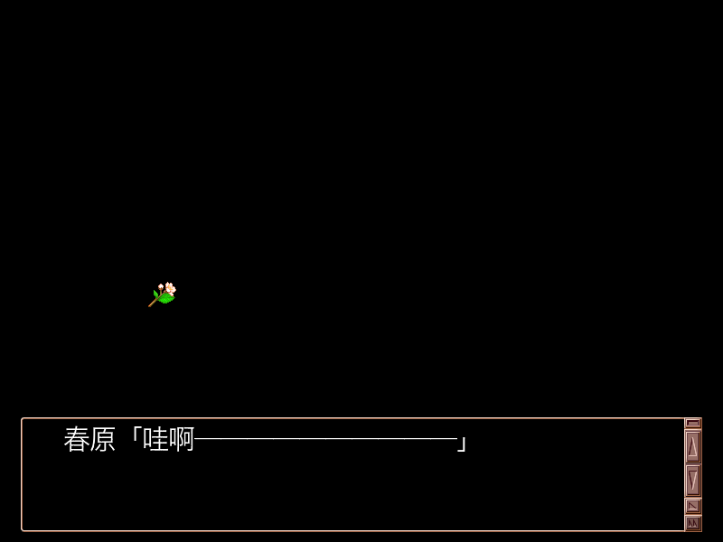
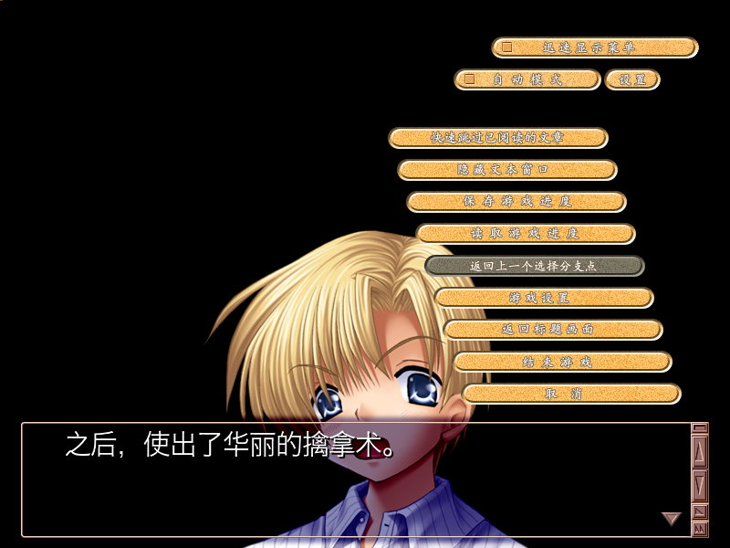

# rlvm, revived for Apple Silicon

A RealLive interpreter — the engine behind Key's Kanon, Air, CLANNAD,
Planetarian, Tomoyo After, Little Busters and Kud Wafter — built and running
on modern macOS.

This is a continuation of [Elliot Glaysher's rlvm](https://github.com/eglaysher/rlvm),
which stopped building around 2015. The goal of this branch is narrower than
the original's: make the tree build with a current toolchain, run correctly on
Apple Silicon, and be pleasant to install.

*Screenshots are from CLANNAD Full Voice, © VisualArts/Key, shown to identify
what the engine renders. They are not part of the software.*

## What works

Verified on an M-series Mac with **CLANNAD Full Voice** (Chinese translation,
231 scenarios, 4 GB of assets):

| | |
| --- | --- |
| Build | debug and release, `scons` under Apple clang and Homebrew |
| Tests | 260/260 unit tests pass |
| Parse | all 231 scenarios of the retail archive |
| Render | title screen, sprites, text, Chinese dialogue, system menu |
| Audio | BGM plays |
| Idle cost | 0.4 % CPU, 8.7 MB RSS |
| App bundle | self-contained; runs where Homebrew was never installed |

## Install

Download the dmg from Releases, drag `rlvm.app` into `/Applications`, and
launch it. Choose your game directory once — the choice is remembered.

RLVM does not ship games. Point it at a directory you own that contains
`Seen.txt` and `Gameexe.ini`.

Two things worth knowing:

- The build is not notarised. If macOS refuses to open it, either right-click
  and choose **Open**, or run `xattr -dr com.apple.quarantine /Applications/rlvm.app`.
- Keep game data **out of cloud-synced folders** (`~/Documents`, synced
  `~/Desktop`). The sync daemon holds directories during its scans and the
  engine can stall on the first `open()`. `/Users/Shared` or any local path is
  fine. See [PERF.md](PERF.md).

## What changed in this revival

The tree had drifted a decade away from current tooling. Each fix is a commit
with its reasoning; the substance:

**Toolchain**

- Homebrew is asked for its own prefix instead of assuming `/usr/local`, and
  for its keg-only `gettext`.
- `boost_system` left the link line: upstream made it header-only in 1.69.
- The build scripts speak Python 3 (`print`, `filter()` returning an iterator,
  `ParseConfig`'s three-argument callback, and a bare `exit` that had never
  actually aborted anything).
- The `SConscript.cocoa` packaging step asks `sdl-config --libs` instead of
  the long-gone `--static-libs`.
- Static archives from Homebrew carry no dependency metadata, so the app's
  closure comes from `pkg-config --static` rather than a hand-written list.
- `cassert` is included where `assert` is used: release builds define
  `NDEBUG` and the transitive include stopped supplying it.

**The app bundle**

- `bundle-dylibs.sh` carries third-party libraries into `Contents/Frameworks`,
  repoints every load at `@rpath`, and signs ad hoc.
- **The bundle never started before.** `sdl12-compat` finds its backend with a
  bare `dlopen()` that no load command mentions: it looks for
  `libSDL2-2.0.0.dylib` beside itself, and that looks for `libSDL3.dylib`. Only
  SDL3 was shipped, so the chain died at the first hop and the app put up an
  error dialog before `main()` ever ran.
- `NSHighResolutionCapable`: without it macOS pixel-doubles the window and the
  renderer never sees a sharp surface.

**Reading real games**

- The bytecode reader decided where text ends using Shift-JIS's lead-byte
  ranges. A translation that re-encodes its text as GBK desynchronised the
  reader and every `select` after it failed. Lead-byte membership is now a
  property of the codepage (`Codepage::IsLeadByte`), and the archive samples
  scenarios to work out which codepage a file needs.
- `FindFontFile` named fonts where 2007 knew them; macOS has moved, renamed
  and unbundled those. It now finds Hiragino Sans GB and friends.

**Using it**

- The Cocoa front end ignored the command line. `rlvm.app /path/to/game` now
  plays that game.
- The last game is remembered, so a second launch needs no dialog.
- Folders can be dropped on the icon.

## Debugging aids

The engine can be made to show what it did, without a debugger:

    RLVM_SCREENSHOT=/path/shot.ppm    write the frame to a PPM
    RLVM_SCREENSHOT_DELAY=90          ... after this many presented frames
    RLVM_SCREENSHOT_EVERY=40          ... or every N frames, numbered
    RLVM_SEEN_START=1                 begin at this scenario
    RLVM_CLICK_SCRIPT="1,400,520;3,400,300"
                                      play back mouse clicks (button,x,y)
    RLVM_CLICK_DELAY=600              ... this many ms apart

`RLVM_SCREENSHOT` reads the engine's own GL back buffer, so it needs no screen
recording permission. Between these, a whole session — advancing text, opening
the menu, saving — can be driven and inspected without a hand on the trackpad.

## Building

    $ brew install scons sdl12-compat boost gettext libogg libvorbis libsndfile
    $ scons --release --fullstatic            # builds build/rlvm.app
    $ scons --release --fullstatic --dmgname="rlvm <version>"
    $ ./build/rlvm_unittests

SDL_mixer, SDL_ttf, SDL_image, GLEW, guichan and zita-resampler build from
`vendor/`; the SDL 1.2 API comes from `sdl12-compat`.

---

The rest of this file is the original project's documentation, kept as it was.

rlvm: A RealLive interpreter for Linux and OSX.
===============================================

## INTRODUCTION

rlvm is a Free Software reimplementation of the VisualArt's KK's
RealLive interpreter. It is meant to provide Linux and Apple users with
a compatible, portable interpreter to play VisualArts games,
specifically those released under the Key label. It is licensed to you
under version 3 or later of the GNU General Public License as published
by the Free Software Foundation.

rlvm is meant to be a compatibility utility; it is not an excuse for
copyright infringement. Please do not acquire games from BitTorrent /
Share / {insert name of popular P2P app in your locale}.

Special thanks to Jagarl for the first work on reverse engineering the
RealLive interpreter and for Free software licensed source code for
decoding their file formats, to Richard 23 for figuring out features
added to RealLive for Little Busters, to \\{jyuichi} for help with Kud Wafter, and to Haeleth for creating rldev, along with answering all my dumb questions about the internal workings of the RealLive system.

## STATUS

rlvm currently plays the following games to their completion:

| Japanese Edition Games | Status          | English Fan Patch Status |
| ---------------------- | --------------- | ------------------------ |
| Kanon Standard Edition | OK              | [NDT's patch][kanon]     |
| Air Standard Edition   | OK              | (None)                   |
| CLANNAD                | OK              | (Not supported)          |
| CLANNAD (Full Voice)   | OK              | [Licensed][clannad]      |
| Planetarian CD         | OK              | [Licensed][planetarian]  |
| Tomoyo After           | OK              | (None)                   |
| Little Busters         | OK              | (Untested)               |
| Kud Wafter             | OK              | (None)                   |

| US Edition Games       | Status                         |
| ---------------------- | ------------------------------ |
| Planetarian            | Works; [buy here][planetarian] |

[kanon]: http://radicalr.pestermom.com/vn.html
[clannad]: http://store.steampowered.com/app/324160/
[planetarian]: http://store.steampowered.com/app/316720/

For more details, please read STATUS.TXT.

rlvm is now at the point where enough commands are implemented that
other games *may* work. The above is only a list of what I've tested
first hand or what I've been told.

rlvm has an implementation of rlBabel; English patches compiled with
Haeleth's rlBabel should line break correctly. I've successfully tested
it with the Kanon patch from NDT.

rlvm supports KOE, NWK and OVK archives for voices, along with ogg
vorbis voice patches which follow the convention
<packnumber>/z<packnumber><sampleid>.ogg.

Fullscreen can be entered by pressing Alt+{F,Enter} on Linux and
Command+{F,Enter} on Mac.

Please report bugs on [the GitHub bug tracker][bugtracker].

[bugtracker]: https://github.com/eglaysher/rlvm/issues

## USING RLVM

By default, rlvm is a GUI program. Start it by double clicking on the
icon [OSX] or selecting it from your Applications menu [Linux]. You will
then want to select the folder that contains the SEEN.TXT of the game
you want to play.

If you are using Ubuntu or OSX, rlvm makes an effort to find a system
Japanese Gothic font. If rlvm is complaining that it can't find a font,
it will also look for the file "msgothic.ttc" in either the game
directory nor your home directory. If you are using Linux, you can
manually specify a font with the --font option.

On Linux, you can also manually start rlvm from the command line,
optionally passing in the directory containing the SEEN.TXT file:

    $ rlvm [/path/to/GameDirectory/]

The rlvm binary should be self contained and movable anywhere, though
the build system does not have an install target.

If you don't have the file "msgothic.ttc" in either the game directory
nor your home directory, please specify a Japanese font on the command
line with --font.

## COMPILING RLVM

You will need the following libraries/utilities:

- The [scons][scons] build system (Note: the scons in MacPorts has been
  reported to not work)
- [boost][boost] 1.40 or higher
- [SDL 1.2][sdl] (and optionally, [SDL_image][sdl_image], and
  [SDL_mixer][sdl_mixer], though there are copies included in the source
  distribution if you don't already have them installed.)
- [freetype][freetype]
- GNU gettext

[scons]: http://www.scons.org/
[boost]: http://www.boost.org/
[sdl]: http://libsdl.org/download-1.2.php
[sdl_image]: https://www.libsdl.org/projects/SDL_image/release-1.2.html
[sdl_mixer]: http://www.libsdl.org/projects/SDL_mixer/release-1.2.html
[freetype]: http://www.freetype.org/

### COMPILING UNDER LINUX

Make sure that freetype-config and sdl-config are in your `$PATH`. The
current SConscripts are fairly naive and may need editing to point to
the correct location of some header files. Future versions will have the
build system refined. You should be able to type:

    $ scons --release

in the root and have a complete build. The unit tests will automatically
be built and can be run by typing:

    $ ./build/rlvm_unittests

They should all pass.

There is no convenient install feature (I am not sure how to do that in
scons). rlvm will work (without icons or localization) in place. If you
wish to use rlvm in place, the binary is in:

    $ ./build/rlvm

For packagers, the debian/install file contains a mapping of where files should be copied to. I agree that there should be a better long term solution, though it currently escapes me.

### COMPILING UNDER OSX

The build asks Homebrew itself for its prefix and for the keg-only
gettext, so nothing needs editing on either Intel or Apple Silicon
machines. Install the dependencies:

    $ brew install scons sdl12-compat boost gettext libogg libvorbis libsndfile

SDL_mixer, SDL_ttf, SDL_image, GLEW, guichan and zita-resampler are
built from the copies in vendor/, and the SDL 1.2 API comes from
sdl12-compat.

To build an OSX application, type:

    $ scons --release --fullstatic

which will build rlvm.app in the build directory. The resulting OSX
application will ask you for the location of the game with a native
dialog. The app is self-contained: it carries its third-party libraries
inside Contents/Frameworks and runs on machines that never had
Homebrew.

To build a dmg file for distribution, type:

    $ scons --release --fullstatic --dmgname="rlvm <version>"

And to run the test suite:

    $ ./build/rlvm_unittests

### INSTALLING THE APP

Drag `rlvm.app` out of the dmg into `/Applications`, then launch it once
and choose your game directory; the choice is remembered.

If macOS refuses to open it because the build is not notarised:

    $ xattr -dr com.apple.quarantine /Applications/rlvm.app

or right-click the app and choose Open, which grants the same permission
for that copy.

**Keep game data out of cloud-synced folders** (`~/Documents`,
`~/Desktop` when iCloud sync is on): the sync daemon holds directories
during its scans and the engine can stall on the very first `open()`.
`/Users/Shared`, `/Applications`, or any local path is fine. See
`PERF.md`.

### Debugging aids

Two environment variables make the engine observable without a debugger:

    RLVM_SCREENSHOT=/path/shot.ppm    write the frame to a PPM
    RLVM_SCREENSHOT_DELAY=90          ... after this many presented frames
    RLVM_SCREENSHOT_EVERY=40          ... or every N frames, numbered

    RLVM_SEEN_START=1                 begin at this scenario

The capture reads the engine's own GL back buffer, so it needs no screen
recording permission.

## KNOWN ISSUES

Little Busters' baseball doesn't work because it is implemented as a
Windows DLL instead. For the same reason, the dungeon crawling minigame
in Tomoyo After does not work.

## GETTING INVOLVED

Little Buster's baseball minigame appears to be implemented by a DLL,
not RealLive bytecode. Figuring out what its doing is the first step to
getting it working.

## DONATE

Have you found rlvm useful? I accept donations in bitcoin at the following address: 3Ee9s6BzmSZQK2yf4DU3p8vk1ttrsnFoQ2
